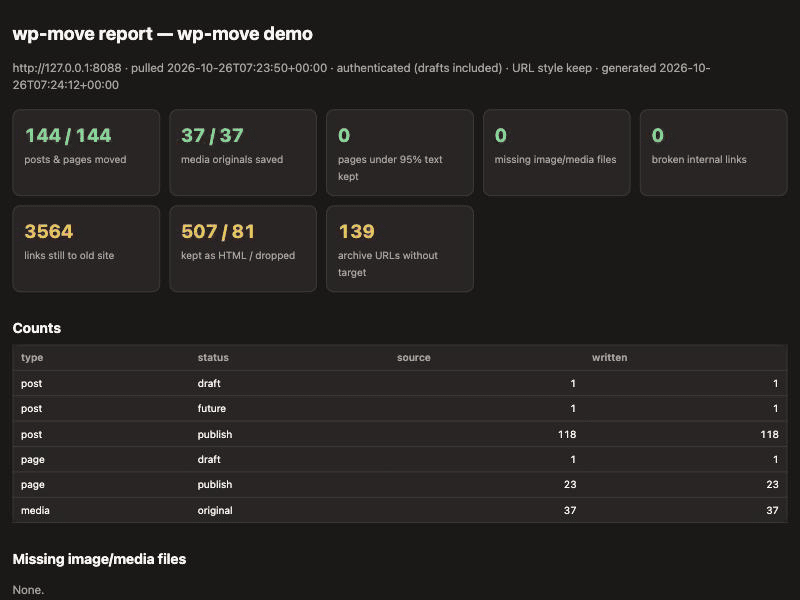

# wp-move

Move a WordPress site you own to Markdown, and get a report that shows what moved, what is missing, and what broke.

Migration tools usually stop at "export finished". wp-move also checks the result: every post, page and media file, how much of each page's text survived, every image and internal link, and whether every old URL redirects to the new one.



*Clean move: everything green. Then one image and one post are deleted from a copy, and the report flags 143/144 items, 36/37 media files and 3 broken image references. The exit code is 2.*

## Quick start

```bash
uv sync
uv run wp-move pull https://your-site.example --out out
open out/report.html
```

Public content works without credentials. To include drafts, scheduled and private posts, create an Application Password in WordPress (Users → Profile) and pass it through the environment only:

```bash
export WPMOVE_USER=your-user
export WPMOVE_APP_PASSWORD='xxxx xxxx xxxx xxxx xxxx xxxx'
uv run wp-move pull https://your-site.example --out out
```

Re-check an output folder at any time, optionally against a server running the generated redirects:

```bash
uv run wp-move report --out out --server http://localhost:8080
```

Without cloning, any release can be run straight from GitHub:

```bash
uvx --from git+https://github.com/AidanKR/wp-move@v0.0.1 wp-move pull https://your-site.example --out out
```

### As an agent skill

[`skills/wp-move/SKILL.md`](skills/wp-move/SKILL.md) lets Claude Code (or another agent that reads skills) run wp-move and summarize the report from `report.json`. Copy it into your skills folder:

```bash
mkdir -p ~/.claude/skills/wp-move && curl -fsSL https://raw.githubusercontent.com/AidanKR/wp-move/v0.0.1/skills/wp-move/SKILL.md -o ~/.claude/skills/wp-move/SKILL.md
```

The skill pins wp-move to a release tag, and it may only run that command and read files. It asks you to set credentials in your own shell instead of pasting them into chat.

## What you get

```
out/
  content/posts/*.md        Markdown with front matter (title, dates, slug, url, status, author,
  content/pages/**/*.md     categories, tags, featured_image, excerpt, old_url, wp_id)
  public/media/...          images and files hosted on your site, paths rewritten in the Markdown
  redirects/_redirects      Netlify-style rules
  redirects/nginx-*.conf    nginx maps + server snippet
  redirects/url-map.csv     old URL -> new path for every item
  report.html, report.json  the verification report
```

## What the report checks

| Check | Fails the run (exit 2) |
|---|---|
| Posts and pages per status: in the source vs written to disk | yes |
| Media originals: in the source vs saved | yes |
| Image/media references in the Markdown that point to a missing file | yes |
| Internal links with no target in the new site | yes |
| Share of each page's source words kept in the Markdown (flags pages under 95%) | no, listed |
| Links that still point at the old site, by kind (archives, admin, home, …) | no, listed |
| Links that only work through a redirect (an old permalink or `?p=` that the redirects send to the new path): not broken, but an extra hop each time | no, listed |
| Canonical URLs (front matter `canonical:` or a kept `<link rel="canonical">`) that point at the old site or an old path | no, listed |
| Content kept as raw HTML, dropped (script/style), or unrendered shortcodes | no, listed |
| Images hosted elsewhere (not downloaded) | no, listed |
| Category/tag archive URLs that have no page yet | no, listed |
| With `--server`: every old URL returns 301 to its new path | listed |

## URLs and redirects

`--url-style keep` (default) keeps every post and page at its old permalink, so only `?p=`, `?page_id=` and `/wp-content/uploads/` need redirects. `--url-style slug` moves posts to `/posts/<slug>/` and adds a redirect for each one. Links between your own posts and pages are rewritten to the new paths in both modes.

## Measured on the demo site

The demo is a local WordPress 7.1.3 seeded with WordPress's official theme test data. Run it with `demo/run-demo.sh`; it needs podman. The numbers below come from runs on 2026-10-26. The `run-demo.sh` output is in [docs/demo-transcript.txt](docs/demo-transcript.txt); the `slug` redirect figure is from a separate run with `--url-style slug`.

| | Result |
|---|---|
| Source | 120 posts (118 published, 1 draft, 1 scheduled), 24 pages (23 published, 1 draft), 37 media |
| Written | 144/144 items, 37/37 media originals (60 files incl. referenced sizes) |
| Pages under 95% text kept | 0 |
| Missing media / broken internal links | 0 / 0 |
| Redirects through nginx 1.30.5 | `keep` 164/164 · `slug` 283/283 |
| Copy with 1 image + 1 post deleted | 143/144 items, 36/37 media, 3 missing image references, exit 2 |

## Not done yet

- Tested only on the theme test data, not on real sites.
- `_redirects` is not yet tested on Netlify or Cloudflare Pages. Its query-string rules (`?p=`) use Netlify's syntax.
- No comment migration, no category/tag archive pages, and no site starter (Next.js/Astro). Archive links show up in the report as "links still to old site".
- Shortcodes are detected but not converted. Blocks that Markdown can't express (tables, embeds, forms, SVG) are kept as HTML.

## Principles

The source site is only read, never written. Nothing is sent anywhere except requests to your own site. Credentials come only from the environment and are never logged. Dependencies are pinned in `uv.lock`, resolved from releases at least two weeks old.

## License

[MIT](LICENSE) © 2026 AidanKR. The demo's test data (WordPress theme test data) is downloaded at run time and is not part of this repository or its license.
